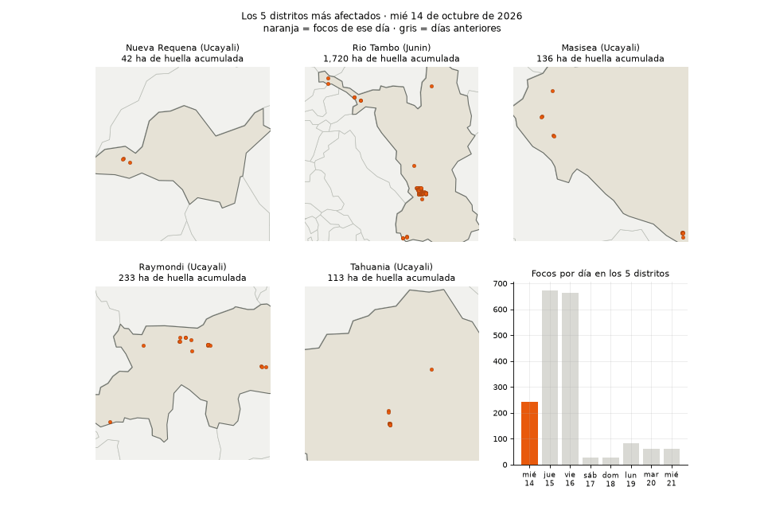
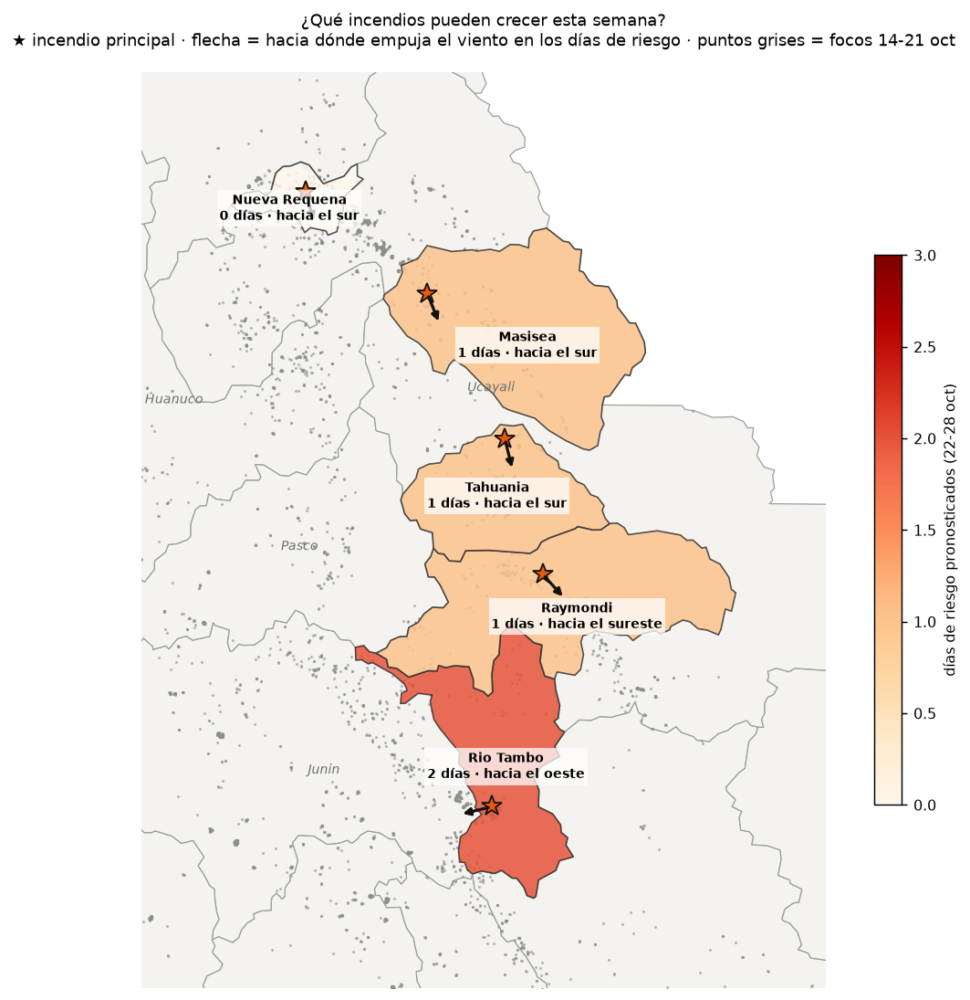
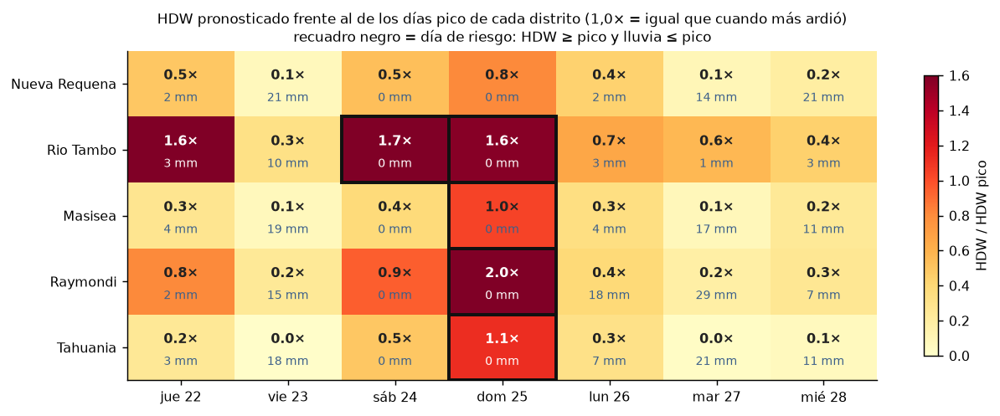
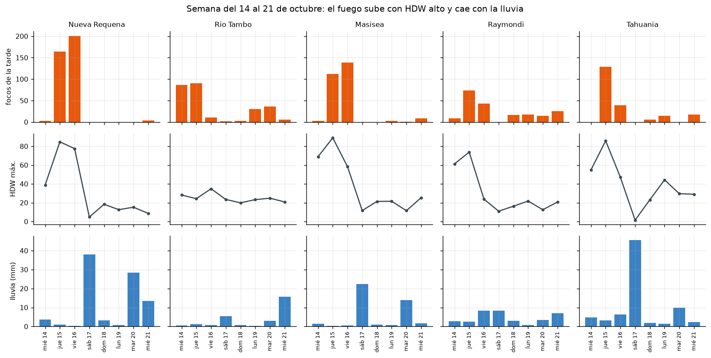
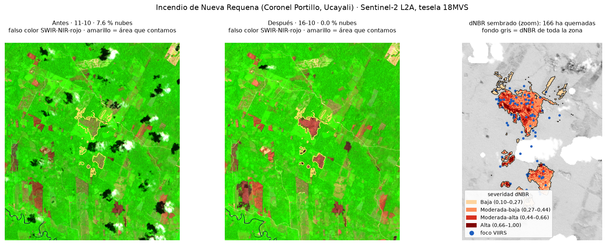

# ¿Qué incendios pueden crecer esta semana?

**Monitor de incendios forestales del Perú · 14 al 28 de octubre de 2026**
Reto F (clima y riesgo) · Ciencia de Datos con Python · Tarea raster del 21 de octubre de 2026



## La pregunta

Los focos de calor dicen **dónde arde hoy**. Este monitor pregunta **dónde puede arder más en
los próximos 7 días**, con humedad, viento y lluvia de Open-Meteo. Para no inventar umbrales,
los calibra con la semana anterior: ¿con qué clima ardió más cada distrito? Si el pronóstico
repite ese clima, el incendio puede crecer.

El análisis se centra en los **5 distritos más afectados** de la semana, medidos por la
huella de sus focos VIIRS.

## Hallazgos

**1 · La lluvia del 17 de octubre cortó el pico de la semana.**
- En el Perú hubo 6 986 focos del 14 al 16 de octubre, frente a 2 963 en los cinco días
  siguientes.
- En los 5 distritos más afectados, los focos de la tarde bajaron de **1 103 a 203**.
- El 17 cayeron en promedio **24 mm** de lluvia sobre esos distritos, y el índice
  calor-sequedad-viento (HDW) no volvió a los niveles del pico.

**2 · El domingo 25 es el día de riesgo, y Río Tambo es el incendio que más puede crecer.**
- Cuatro de los cinco distritos tienen el **domingo 25 de octubre** como día de riesgo: 0 mm
  de lluvia y un HDW igual o mayor al de sus días pico. En Raymondi llega a 2,0 veces su pico.
- **Río Tambo** (Satipo, Junín) es el único con **dos días de riesgo** (sábado 24 y domingo
  25) y el que menos lluvia espera: **19 mm** en la semana, frente a 55–72 mm en Ucayali. El
  viento empujaría el fuego hacia el oeste.
- **Nueva Requena**, el distrito con más huella, no tiene ningún día de riesgo (su HDW
  máximo es 0,8 veces el de su pico): *el distrito más afectado no es el que más puede
  crecer*.

**3 · La huella VIIRS infla el área 2,5 veces.**
- El incendio principal de Nueva Requena quemó **166 ha** según el dNBR de Sentinel-2. Su
  huella VIIRS era de 412 ha.
- El 69 % del área tiene severidad moderada o alta.
- Según WorldCover 2021, el 96 % de lo quemado era bosque.





| Puesto | Distrito | Huella 14-21 oct | Días de riesgo | HDW máx. vs pico | Lluvia 22-28 oct | El viento empuja hacia |
|---|---|---|---|---|---|---|
| 1 | Río Tambo (Junín) | 3 691 ha | 2 (sáb 24, dom 25) | 1,7× | 19 mm | oeste |
| 2 | Raymondi (Ucayali) | 2 643 ha | 1 (dom 25) | 2,0× | 72 mm | sureste |
| 3 | Tahuania (Ucayali) | 2 319 ha | 1 (dom 25) | 1,1× | 60 mm | sur |
| 4 | Masisea (Ucayali) | 3 179 ha | 1 (dom 25) | 1,0× | 55 mm | sur |
| 5 | Nueva Requena (Ucayali) | 3 865 ha | 0 | 0,8× | 60 mm | sur |

## Los datos y sus fechas

| Dato | Fuente | Tipo | Fecha |
|---|---|---|---|
| Focos de calor | NASA FIRMS, VIIRS «South America 7d» (S-NPP, NOAA-20, NOAA-21) | Puntos (CSV) | 14-oct 00:14 → 21-oct 14:19 (hora de Lima) |
| Límites distritales | INEI con UBIGEO ([peru-geojson](https://github.com/juaneladio/peru-geojson)) | Polígonos | — |
| Cobertura del suelo | ESA WorldCover v200, 10 m (Planetary Computer) | Raster | 2021 |
| Clima y pronóstico | Open-Meteo, API sin clave | Serie diaria y horaria | 13-oct → 28-oct, bajado el 21-oct |
| Área quemada | Sentinel-2 L2A, tesela 18MVS (Planetary Computer) | Raster | 11-oct (7,6 % de nubes) y 16-oct (0 % de nubes) |

Ninguna fuente pide clave ni pago, y todo corre en CPU en menos de 2 minutos. Los focos y el
pronóstico cambian cada día, así que quedan guardados en `data/`. Para actualizar el monitor,
borra `data/focos_viirs_peru_7d.csv` y `data/open_meteo_top5.json` y vuelve a correr el
notebook.

## El método

Todo está en [`Tarea_Raster.ipynb`](Tarea_Raster.ipynb):

1. **Focos.** Unimos los 3 satélites VIIRS, los cruzamos con los distritos (punto en polígono)
   y pasamos la hora a la de Lima.
2. **Limpieza con un raster.** Leemos WorldCover bajo cada foco y descartamos los que caen en
   desierto, agua, nieve o zona construida: 723 focos (7,3 %). Son el desierto costero
   caliente, fuentes fijas como Paracas y reflejos del sol en ríos. Para ir rápido usamos el
   *overview* a ~80 m: 12 segundos en lugar de 8 minutos.
3. **Incendios.** Dos focos son el mismo incendio si están a ≤ 1 km y ≤ 48 h (componentes
   conexos de un grafo, en UTM 18S). La huella es la unión de los píxeles VIIRS de 375 m.
4. **Calibración.** En el incendio principal de cada distrito calculamos el HDW (déficit de
   presión de vapor × viento; Srock et al., 2018) y la lluvia. Los **días pico** son los que
   tienen al menos la mitad de los focos de la tarde del día récord.
5. **Día de riesgo** = día pronosticado con HDW ≥ el de los días pico y lluvia ≤ la de los
   días pico. Para la dirección de avance usamos el promedio circular del viento.
6. **dNBR.** NBR = (B08 − B12)/(B08 + B12) a 20 m. Restamos el offset de 1000 de las imágenes
   desde 2022 y enmascaramos nubes con la capa SCL. Contamos solo las manchas con dNBR ≥ 0,10
   que tocan un foco del incendio («sembrado»). Las hectáreas por distrito y la cobertura
   quemada salen con `zonal_stats`.





El mapa animado de todo el Perú está en [`outputs/evolucion_focos.html`](outputs/evolucion_focos.html).
GitHub no lo muestra: hay que descargarlo y abrirlo en el navegador.

## Limitaciones

- **Un foco de calor no es un incendio.** La limpieza usa WorldCover de 2021, leído a ~80 m,
  y puede descartar algún incendio real en la ribera de un río. A la inversa, **no todo
  incendio deja foco**: las nubes, el humo y los fuegos chicos o bajo el dosel no se ven.
- **Las nubes esconden el fuego.** Un día de lluvia es un día nublado, así que parte de la
  caída del 17 puede ser que el satélite no pudo mirar. En la selva, además, las nubes deciden
  qué incendio se puede medir: Río Tambo y Raymondi no tienen ninguna imagen Sentinel-2
  despejada posterior al fuego.
- **Open-Meteo es un modelo, no una estación.** Da una celda de ~10 km en el incendio
  principal, no el frente del fuego. El HDW es la versión de superficie: sirve para comparar
  días, no para usar los umbrales publicados.
- **La calibración es corta**: 8 días y 5 distritos. «Puede crecer» no es «va a crecer»: en
  la selva casi todos los fuegos los prende la gente. El clima abre la ventana.
- **El dNBR depende de las decisiones**: son 115 ha con umbral 0,27 y 166 ha con 0,10. La
  imagen «después» es de la mañana del último día con focos.

## Cómo correrlo

```bash
# desde el repositorio del curso (Data-Science-Python)
uv sync --group raster --group geo
uv run jupyter lab   # abrir Tarea_Raster.ipynb con el kernel "Python (ds-python-up)"
```

Usa `geopandas`, `rasterio`, `rasterstats`, `pystac-client`, `planetary-computer`, `scipy`,
`plotly` y `matplotlib`.

> Herramienta independiente con fines académicos: no reemplaza los reportes del COEN,
> INDECI, SERFOR ni SERNANP.
